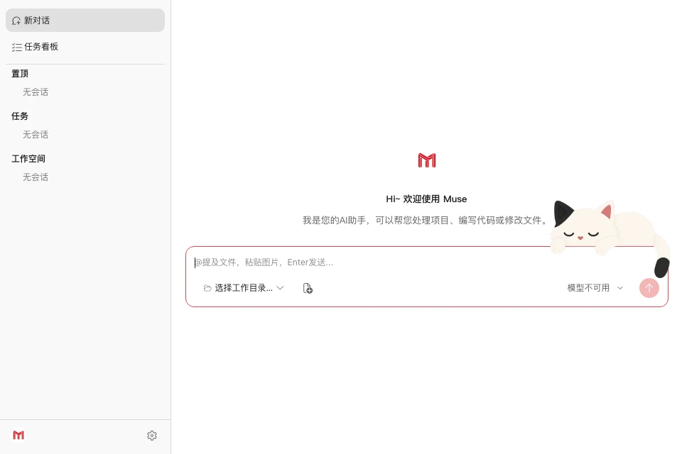

# Muse Work

AI 编程工作桌面应用：本地优先的 Agent 对话 + 代码工作台，基于 Electron 与自托管本地 server（HTTP + WebSocket）构建。



## 特性

- **本地优先** — Agent 运行时是随应用启动的本地 server，会话与凭证数据都在本机，不依赖云端控制台。
- **可插拔 Provider** — 支持 CodeMaker（SSO 登录）与任意 OpenAI 兼容服务（API Key 注入），顶栏可随时切换 Provider 与 model。
- **新会话氛围页** — 深色 / 浅色各三张内置壁纸，进入欢迎页时按当前主题随机抽取；四张玻璃卡片（理解项目 / 写新功能 / 修改文件 / 排查问题）点击后填入输入框，不自动发送。
- **工作目录 + Git 集成** — 选择/切换工作目录，头部展示当前 Git 分支，支持 worktree 创建与切换。
- **Issue** — 一件事一条线：侧栏待办分组，UI 或对话都能登记；默认单 agent 一条会话干完，也可规划 + 执行（规划定方案、执行改代码，清单做完进入待审核）。
- **四类工作面板** — 文件浏览、Diff 差异对比、页面预览、终端，与当前工作目录联动，一键开合：
  - **Diff 面板**：查看工作区变更，可直接 commit 或丢弃（支持单文件/全部）。
  - **预览面板**：渲染本地页面或远程 URL。
- **会话管理** — 会话树（置顶 / 待办事项 / 任务 / 工作空间）、重命名、删除确认、会话搜索。
- **文件智能交互** — `@` 提及文件（级联目录浏览）、拖拽/粘贴/本地文件选择、Quick Open 快速搜索、代码/图片预览。
- **Agent 能力** — 子 Agent（subagent）、MCP 工具、slash commands、工具调用权限确认、任务列表、后台任务。
- **消息体验** — 流式输出、消息队列（可编辑/删除排队消息）、rewind 回退、会话压缩提示。压缩后打开会话先看到摘要之后的对话；往上翻再加载更早的记录，界面上没有单独的加载按钮。
- **POPO** — 主人私聊或群里 @ 机器人的消息进入 Muse Bot，由助理回复。

## 快速开始

要求：Node.js >= 20，pnpm 9.15.0。

```bash
pnpm install

# 首次运行前配置 Provider（可跳过，使用内置默认）
mkdir -p ~/.muse-work
cp packages/provider/providers.json.example ~/.muse-work/providers.json

# 启动桌面应用（自动拉起本地 server）
pnpm dev:desktop
```

## 配置

Provider 配置位于 `~/.muse-work/providers.json`（默认端口 `8787`）：

- **CodeMaker**：优先复用本机 CodeMaker 登录态（`~/.muse-work/auth/codemaker.json` → 本机 CodeMaker `auth.json`），未登录时可在应用内发起 SSO。
- **OpenAI 兼容**：编辑 `baseURL` / `apiKeyEnv`，通过环境变量注入 API Key（默认 `MUSE_OPENAI_API_KEY`）。
- **Agent 运行时**：用户级 `~/.muse-work/settings.json`；环境变量用 `MUSE_*`（仍可读遗留 `WAVE_*`），详见 [`packages/agent/README.md`](packages/agent/README.md)。

## Issue

把「一件要做成的事」登记成 Issue，侧栏 **待办事项** 按这件事分组，规划会话和执行会话都挂在同一条线上。UI 里新建，或在对话 / POPO 里随口说一句「建个 issue」都行。

打开会话时选定工作目录，并选一种干活方式（选定后不可改）：

- **单 agent**（默认）— 一条会话里把需求聊清、把代码改完，小事直接开干。
- **规划 + 执行** — 规划会话只定方案、维护清单，**禁止改源码**；真正动代码交给同一个执行会话。清单做完进入待审核，人继续跟规划 AI 收口，没有「打回」这回事。

规划 + 执行适合更大、需要拆步骤的事：方案和改代码不搅在同一条上下文里，仓库不会边聊边被改乱；执行会话从头干到尾、上下文连续；每一步都要规划对照清单验收，执行完不会自动勾完成。

待办里只留进行中的事；完成或取消后分组消失，聊天记录还在。

## POPO

在 POPO 开放平台创建机器人，把消息事件回调指向本机。主人的**私聊**和**群里 @** 都会进入 Muse Bot，由助理决定怎么回。

### 配置

1. 在本机创建 `~/.popo-config.json`（权限 0600，含机器人凭据与回调验签参数）：

```json
{
  "appId": "<App ID>",
  "appKey": "<App Key>",
  "appSecret": "<App Secret>",
  "token": "<回调 token>",
  "aesKey": "<回调 aesKey>",
  "masterUid": "you@corp.netease.com"
}
```

2. 在开放平台后台「事件订阅」配置回调地址 `http://<局域网 IP>:3100/popo/callback`，订阅消息事件。

### 使用

- **主人私聊 / 群里 @ 机器人** → 消息交给 Muse Bot。私聊会记进 Muse Bot 的对话；回复由助理用 `SendMessage` 发回
- **其他人发消息**一律回复「大胆，只有尊敬的大人可以指挥我做事」
- 回调配置在设置里查看。模型用场景默认模型里的 **AI 助手**
- 回调端口默认 `3100`，dev 可用环境变量 `POPO_CALLBACK_PORT` 覆盖；端口被占用或未配置时自动降级，不影响主应用

## 使用

| 操作 | 快捷键（macOS / 其他） |
|---|---|
| 打开终端面板 | `Ctrl` + `` ` `` |
| 打开预览面板 | `⌘`/`Ctrl` + `Shift` + `P` |
| 打开 Diff 面板 | `⌘`/`Ctrl` + `Shift` + `D` |
| 打开文件面板 | `⌘`/`Ctrl` + `Shift` + `F` |

## 项目结构

| 包 | 职责 |
|---|---|
| `@muse-work/desktop` | Electron 壳：拉起本地 server、加载 webview、窗口/工作目录/本地文件能力（`productName`: Muse） |
| `@muse-work/webview` | 对话 UI、model 选择、登录入口、各类面板 |
| `@muse-work/server` | Agent 宿主：会话 / 消息流 / 权限，HTTP + WebSocket API |
| `@muse-work/agent` | Agent 运行时（从 `wave-agent-sdk` fork，本仓维护） |
| `@muse-work/provider` | Provider 接口、凭证、签名、`providers.json` 配置 |

## 开发

```bash
# 构建 / 测试 / 类型检查（全 workspace）
pnpm build
pnpm test
pnpm type-check

# 仅 server（开发模式，可指定端口）
pnpm dev:server            # 等价：pnpm -F @muse-work/server dev -- --port 8787

# 桌面端（构建 server + webview，编译 desktop，启动 Electron）
pnpm dev:desktop

# 打包 macOS 安装包
pnpm dist:mac
```

### 测试

```bash
# 全 workspace 单元/组件测试
pnpm test

# API 冒烟（/health、/providers、/auth/status、/sessions）
./scripts/smoke-mvp.sh
```

## 相关文档

- 截图与说明：`docs/public/screenshots/`
- 集成说明：[`docs/popo-robot-integration.md`](docs/popo-robot-integration.md)
