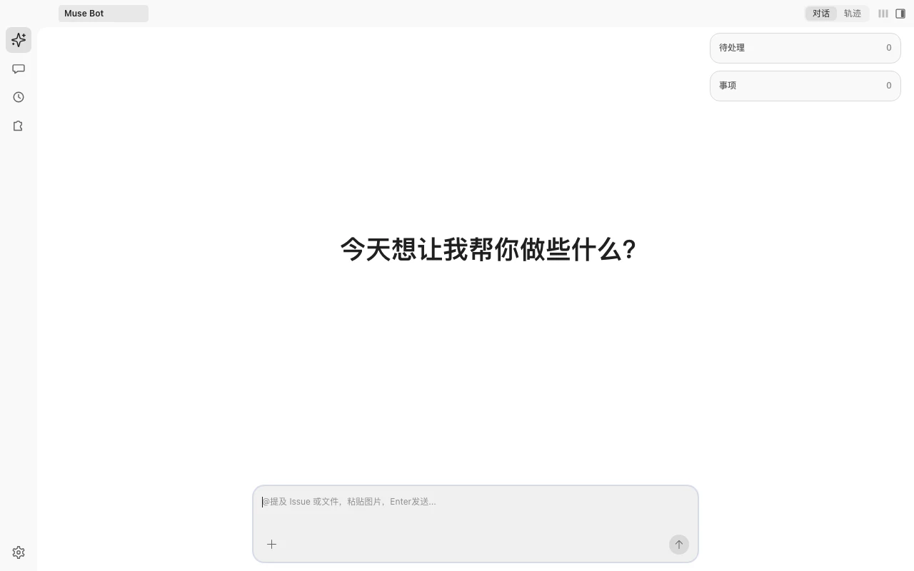

# Muse Work

以 Personal Agent 为核心的 AI 工作台。助手同时推进多件事，并主动跟踪每件事的进展，把下一步接上。你不用再在多个会话之间来回切换。



## 助手

助手是这台工作台的核心。你告诉它要办的事，它负责推进，而不是停在一轮对话里。

- **多事项推进** — 每件事单独一条线。几件事可以同时进行；同一件事的后续步骤接着原来那条做，只有确实要并行时才另开一条。
- **主动跟踪** — 一轮做完，助手自己看做到哪了：该汇报就说出结论，还要往下做就接上下一步。卡住或跑偏时它会盯着，不用你反复去问进度。
- **你来拍板** — 范围分叉、要审核的决定交给你。做法、命名、落点这类它自己定，只把结果告诉你。需要批准的操作会先问你。
- **到点就做** — 每天、定时要看的事登记成自动化。到点助手去查或提醒，不用你守着。

## 工作台

- **打开即助手** — 左侧入口是助手、会话、自动化、技能、设置。打开应用先到助手。右上角是待处理和正在推进的事项；事项会话以标签开在旁边，不进会话列表。
- **右侧面板** — 详情、文件、终端、浏览器、变更，可整栏收起。文件和变更跟着当前事项；浏览器、终端在助手上可以多开。
  - **变更**：查看工作区 diff，可直接 commit 或丢弃（支持单文件/全部）。
  - **浏览器**：打开本地页面、HTML 文件或远程 URL。
- **会话** — 点开「会话」才出现列表：新对话、置顶、任务、工作空间。可重命名、置顶、删除。新对话页有四张卡片（理解项目 / 写新功能 / 修改文件 / 排查问题），点击后只填入输入框。
- **工作目录 + Git** — 选择/切换工作目录，展示当前 Git 分支，支持 worktree 创建与切换。
- **事项** — 一件事一条线。登记后出现在助手的事项里。默认一条会话干完；方向不清的大事可以先规划再执行（规划定方案、执行改代码，清单做完进入待审核）。
- **技能** — 查看已安装技能，从技能市场安装。装上之后助手和会话都能用。
- **文件交互** — `@` 提及文件（级联目录浏览）、拖拽/粘贴/本地文件选择、Quick Open 快速搜索、代码/图片预览。
- **消息体验** — 流式输出、消息队列（可编辑/删除排队消息）、rewind 回退、会话压缩提示。压缩后打开会话先看到摘要之后的对话；往上翻再加载更早的记录，界面上没有单独的加载按钮。

## 快速开始

要求：Node.js >= 24，pnpm 10。

```bash
pnpm install

# 首次运行前配置 Provider（可跳过，使用内置默认）
mkdir -p ~/.muse-work
cp packages/provider/providers.json.example ~/.muse-work/providers.json

# 启动桌面应用（自动拉起本地 server）
pnpm dev:desktop
```

## 配置

Provider 配置位于 `~/.muse-work/providers.json`（默认端口 `8787`）：

- **DeepSeek**：到 [DeepSeek 开放平台](https://platform.deepseek.com/api_keys) 注册并创建 API Key。密钥写在环境变量 `DEEPSEEK_API_KEY`，或由设置页弹窗写入 `~/.muse-work/env`。未配置时发消息会提示填写。
- **OpenAI 兼容**：编辑 `baseURL` / `apiKeyEnv`，通过环境变量注入 API Key（默认 `MUSE_OPENAI_API_KEY`）。
- **Agent 运行时**：用户级 `~/.muse-work/settings.json`；环境变量用 `MUSE_*`（仍可读遗留 `WAVE_*`），详见 [`packages/agent/README.md`](packages/agent/README.md)。

## 事项怎么推进

把「一件要做成的事」登记成事项。它出现在助手的事项里，点开后是中间的会话标签；规划会话和执行会话都挂在同一条线上。助手可以自己建，你也可以在界面里新建。会话列表里不出现这些事项。

打开会话时选定工作目录，并选一种干活方式（选定后不可改）：

- **单 agent**（默认）— 一条会话里把需求聊清、把代码改完，小事直接开干。
- **规划 + 执行** — 规划会话只定方案、维护清单，**禁止改源码**；真正动代码交给同一个执行会话。清单做完进入待审核，人继续跟规划 AI 收口，没有「打回」这回事。

规划 + 执行适合更大、需要拆步骤的事：方案和改代码不搅在同一条上下文里，仓库不会边聊边被改乱；执行会话从头干到尾、上下文连续；每一步都要规划对照清单验收，执行完不会自动勾完成。

事项里只留进行中的事；完成或取消后从列表消失，聊天记录还在。助手会在一轮结束后决定是汇报、继续做，还是两件一起。

## 使用

| 操作 | 快捷键（macOS / 其他） |
|---|---|
| 打开终端 | `Ctrl` + `` ` `` |
| 打开浏览器 | `⌘`/`Ctrl` + `Shift` + `P` |
| 打开变更 | `⌘`/`Ctrl` + `Shift` + `D` |
| 打开文件 | `⌘`/`Ctrl` + `Shift` + `F` |
| 显示或收起右侧面板 | `⌘`/`Ctrl` + `J` |

## 项目结构

| 包 | 职责 |
|---|---|
| `@muse-work/desktop` | Electron 壳：拉起本地 server、加载 webview、窗口/工作目录/本地文件能力（`productName`: Muse） |
| `@muse-work/webview` | 对话 UI、model 选择、登录入口、各类面板 |
| `@muse-work/server` | Agent 宿主：会话 / 消息流 / 权限，HTTP + WebSocket API |
| `@muse-work/agent` | Agent 运行时（从 `wave-agent-sdk` fork，本仓维护） |
| `@muse-work/provider` | Provider 接口与 `providers.json` 配置 |

## 开发

```bash
# 构建 / 测试 / 类型检查（全 workspace）
pnpm build
pnpm test
pnpm type-check

# 仅 server（开发模式，可指定端口）
pnpm dev:server            # 等价：pnpm -F @muse-work/server dev -- --port 8787

# 桌面端（构建 server + webview，编译 desktop，启动 Electron）
pnpm dev:desktop

# 打包 macOS 安装包
pnpm dist:mac

# 发布：选择 patch / minor / major，更新所有包的版本，推送 tag。Actions 打出 dmg
pnpm release
pnpm release --dry-run
```

`pnpm release` 在 main 上完成一次发布。它先让你选 patch、minor 或 major，再把这个版本写进每个 workspace 包并提交，然后推送对应的 tag。GitHub Actions 打出 dmg，挂到这个 tag 的 Release。已安装的应用启动后会检查一次，之后每 6 小时再查。设置页右上角有「检查更新」。启动后每 6 小时查到新版本时，侧栏底部、设置图标上方会出现「更新」，点开后才提示：界面和服务可以重启生效，换了桌面程序则下载 dmg。安装包会下到「下载」，打开后把 Muse 拖进「应用程序」（/Applications）覆盖安装。仓库需要是公开的，应用才能匿名读到 Release。

### 测试

```bash
# 全 workspace 单元/组件测试
pnpm test

# API 冒烟（/health、/providers、/auth/status、/sessions）
./scripts/smoke-mvp.sh
```

## 相关文档

- 截图与说明：`docs/public/screenshots/`
