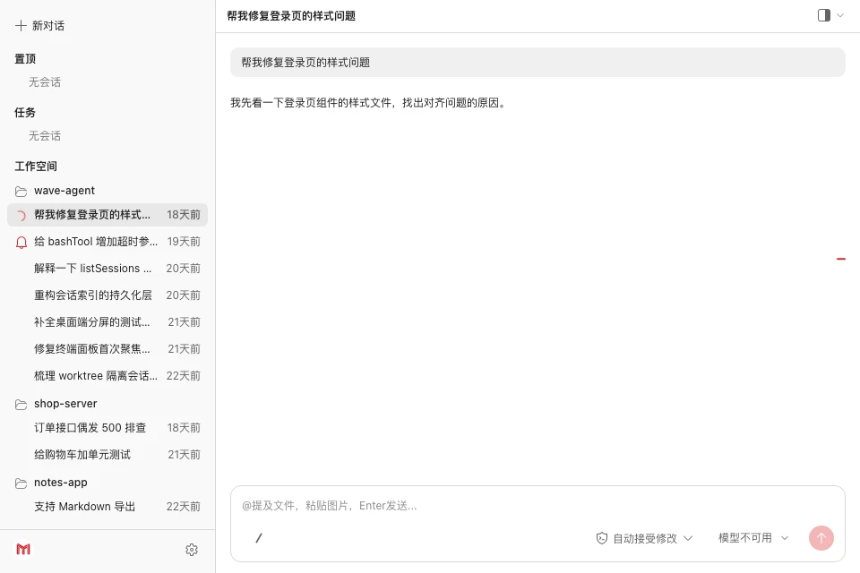

# Muse Work

AI 编程工作桌面应用：本地优先的 Agent 对话 + 代码工作台，基于 Electron 与自托管本地 server（HTTP + WebSocket）构建。



## 特性

- **本地优先** — Agent 运行时是随应用启动的本地 server，会话与凭证数据都在本机，不依赖云端控制台。
- **可插拔 Provider** — 支持 CodeMaker（SSO 登录）与任意 OpenAI 兼容服务（API Key 注入），顶栏可随时切换 Provider 与 model。
- **工作目录 + Git 集成** — 选择/切换工作目录，头部展示当前 Git 分支，支持 worktree 创建与切换。
- **四类工作面板** — 文件浏览、Diff 差异对比、页面预览、终端，与当前工作目录联动，一键开合：
  - **Diff 面板**：查看工作区变更，可直接 commit 或丢弃（支持单文件/全部）。
  - **预览面板**：渲染本地页面或远程 URL。
- **会话管理** — 会话树（固定 / 最近分组）、重命名、删除确认、会话搜索。
- **文件智能交互** — `@` 提及文件（级联目录浏览）、拖拽/粘贴/本地文件选择、Quick Open 快速搜索、代码/图片预览。
- **Agent 能力** — 子 Agent（subagent）、MCP 工具、slash commands、工具调用权限确认、任务列表、后台任务。
- **消息体验** — 流式输出、消息队列（可编辑/删除排队消息）、rewind 回退、会话压缩提示。

## 快速开始

要求：Node.js >= 20，pnpm 9.15.0。

```bash
pnpm install

# 首次运行前配置 Provider（可跳过，使用内置默认）
mkdir -p ~/.muse-work
cp packages/provider/providers.json.example ~/.muse-work/providers.json

# 启动桌面应用（自动拉起本地 server）
pnpm dev:desktop
```

## 配置

Provider 配置位于 `~/.muse-work/providers.json`（默认端口 `8787`）：

- **CodeMaker**：优先复用本机 CodeMaker 登录态（`~/.muse-work/auth/codemaker.json` → 本机 CodeMaker `auth.json`），未登录时可在应用内发起 SSO。
- **OpenAI 兼容**：编辑 `baseURL` / `apiKeyEnv`，通过环境变量注入 API Key（默认 `MUSE_OPENAI_API_KEY`）。

## 使用

| 操作 | 快捷键（macOS / 其他） |
|---|---|
| 打开终端面板 | `Ctrl` + `` ` `` |
| 打开预览面板 | `⌘`/`Ctrl` + `Shift` + `P` |
| 打开 Diff 面板 | `⌘`/`Ctrl` + `Shift` + `D` |
| 打开文件面板 | `⌘`/`Ctrl` + `Shift` + `F` |

## 项目结构

| 包 | 职责 |
|---|---|
| `@muse-work/desktop` | Electron 壳：拉起本地 server、加载 webview、窗口/工作目录/本地文件能力（`productName`: Muse） |
| `@muse-work/webview` | 对话 UI、model 选择、登录入口、各类面板 |
| `@muse-work/server` | Agent 宿主：会话 / 消息流 / 权限，HTTP + WebSocket API |
| `@muse-work/provider` | Provider 接口、凭证、签名、`providers.json` 配置 |

## 开发

```bash
# 构建 / 测试 / 类型检查（全 workspace）
pnpm build
pnpm test
pnpm type-check

# 仅 server（开发模式，可指定端口）
pnpm dev:server            # 等价：pnpm -F @muse-work/server dev -- --port 8787

# 桌面端（构建 server + webview，编译 desktop，启动 Electron）
pnpm dev:desktop

# 打包 macOS 安装包
pnpm dist:mac
```

### 测试

```bash
# 全 workspace 单元/组件测试
pnpm test

# API 冒烟（/health、/providers、/auth/status、/sessions）
./scripts/smoke-mvp.sh
```

## 相关文档

- 产品设计：[`docs/superpowers/specs/2026-08-12-muse-work-design.md`](docs/superpowers/specs/2026-08-12-muse-work-design.md)
- 更多设计规格与截图：`docs/superpowers/specs/`、`docs/public/screenshots/`
