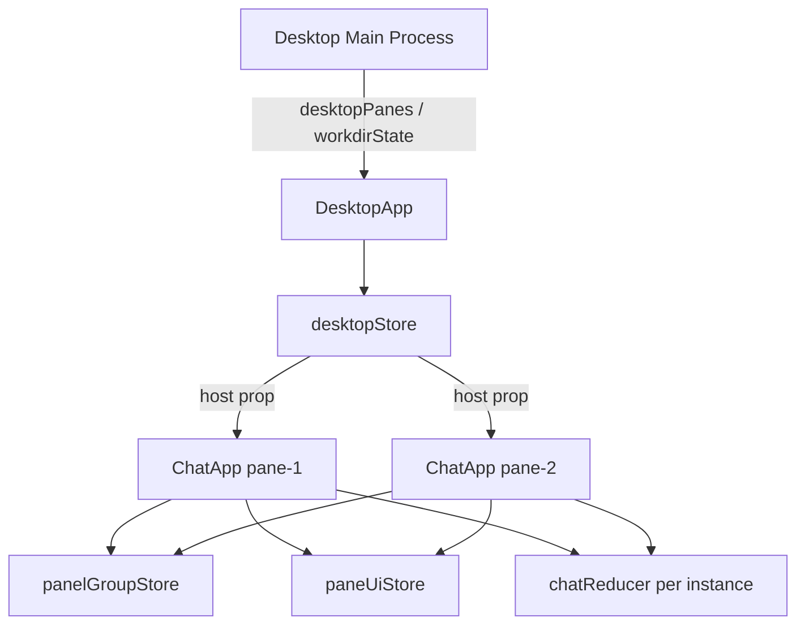

# Webview Zustand 状态管理设计

**日期**：2026-08-15  
**状态**：已评审（2026-08-15 对话确认）  
**范围**：`packages/webview` — 除 `chatReducer` 外的 UI / 布局状态

## 1. 目标

- 在 webview 包引入 [Zustand](https://github.com/pmndrs/zustand)（`^5.x`），替代 `ChatApp` / `DesktopApp` 中散落的 `useState` 与模块级 `panelGroupCache`。
- **保留** `useReducer(chatReducer)` 及全部 `dispatch` 路径不变；聊天业务状态（messages、sessions、streaming、dialogs 等）继续由 reducer 管理。
- 降低 `ChatApp.tsx`（~2440 行）中 UI 状态与渲染逻辑的耦合，使多分屏 Desktop 下的 per-pane / per-session 状态边界更清晰。
- **行为不变**：现有 vitest 组件测试全部通过，不引入用户可见的交互或布局变化。

## 2. 决策摘要

| 项 | 选择 |
|---|---|
| 状态库 | Zustand `^5.x`（仅 `@muse-work/webview` 依赖） |
| Store 数量 | **3 个全局 store**（见 §4） |
| chatReducer | **不迁移** |
| 持久化 | 不做（无 persist middleware） |
| DevTools | 不引入（YAGNI） |
| 迁移策略 | 4 步增量 PR，每步可独立测试 |
| 测试隔离 | 新增 `resetWebviewStores()`，`beforeEach` 调用 |

## 3. 现状与问题

### 3.1 当前状态分布

| 位置 | 机制 | 内容 |
|------|------|------|
| `ChatApp.tsx` | `useReducer(chatReducer)` | messages、sessions、streaming、activeDialog、queue 等 |
| `ChatApp.tsx` | ~20 个 `useState` | popup、toast、worktree、面板 mirror 等 |
| `ChatApp.tsx` | 模块级 `panelGroupCache: Map<string, PanelGroupState>` | 会话级 preview/diff/terminal/file 面板 |
| `DesktopApp.tsx` | 5 个 `useState` | workdir、sessionTree、panes、rowHeights、focusedPaneId |

### 3.2 痛点

1. **ChatApp 职责过重**：业务 reducer 与大量局部 UI 状态混在同一组件。
2. **panelGroupCache 与 useState 双写**：面板状态先写 local state，再用 effect 同步到 Map；`groupKey` 切换时再 bulk setState，逻辑冗长且易漏。
3. **多分屏隔离靠 convention**：宿主消息带 `paneId` 路由，但 UI 状态仍是组件内 `useState`；同一文件里 ref + effect 模式重复出现。
4. **测试依赖模块级 Map**：`chatAppPanels.test.tsx` 在 `beforeEach` 调 `prunePanelGroupCache(new Set())` 做隔离。

## 4. 架构：三个 Store

```
packages/webview/src/stores/
  paneKey.ts           # paneStoreKey(paneId?) 工具
  desktopStore.ts      # Desktop 壳层（窗口级，1 份）
  panelGroupStore.ts   # 会话级 dock 面板（按 groupKey）
  paneUiStore.ts       # pane 级临时 UI（按 paneId）
  index.ts             # 统一导出 + resetWebviewStores()
```

### 4.1 `desktopStore` — 窗口级壳层

**职责**：Desktop 宿主通过 `postMessage` 推送的、整个窗口共享的布局与 workdir 信息。

**State**

| 字段 | 类型 | 来源消息 |
|------|------|----------|
| `workdirState` | `DesktopWorkdirState \| null` | `desktopWorkdirState` |
| `sessionTree` | `DesktopSessionGroup[]` | `desktopSessionTree` |
| `panes` | `DesktopPane[]` | `desktopPanes` |
| `rowHeights` | `number[] \| undefined` | `desktopPanes` |
| `focusedPaneId` | `string \| null` | `desktopPanes` |

**Actions**：`setWorkdirState`、`setSessionTree`、`setPanes(panes, rowHeights, focusedPaneId)`、`reset()`。

**消费者**：仅 `DesktopApp.tsx`。消息 handler 保留在组件内，setter 改为 store action；`host` prop 仍组装后传给 `ChatApp`（接口不变）。

**生命周期**：与 Desktop 窗口同长；全局单例。

---

### 4.2 `panelGroupStore` — 会话级 Dock 面板

**职责**：替代 `panelGroupCache`，管理每个会话（或 draft bucket）的右侧 preview / diff / terminal / file 面板状态。

**State**

```ts
interface PanelGroupState {
  checked: DesktopPanelKind[];
  mounted: DesktopPanelKind[];
  active: DesktopPanelKind | null;
  widths: Record<DesktopPanelKind, number>;
  previewUrl: string | null;
  fileView: FileViewState | null;
  forward: RemoteForwardRef | null;
  forwardError: string | null;
}

interface PanelGroupStoreState {
  groups: Record<string, PanelGroupState>;
  previewEpochs: Record<string, number>; // 同 URL 强制 remount 预览
}
```

**groupKey 规则**（与现有一致）

| 场景 | key |
|------|-----|
| 单窗已绑定 session | `currentSession.id` |
| 单窗新对话 draft | `__draft__`（只读空默认值，**不写入** groups） |
| 分屏 pane 已绑定 | `sessionId` |
| 分屏 pane 未绑定 | `new:${paneId}` |

**Actions**

| Action | 行为 |
|--------|------|
| `ensureGroup(key)` | 不存在则创建 `emptyPanelGroup()` |
| `patchGroup(key, patch)` | 浅合并；支持 `(group) => Partial<PanelGroupState>` |
| `migrateGroup(fromKey, toKey)` | 新会话首条消息绑定 session 时，draft bucket → session id |
| `pruneGroups(keepKeys)` | 删 session / pane 时清理；**导出别名** `prunePanelGroupCache` |
| `findGroupKeyByForwardRequestId(id)` | `desktopForwardPortResult` 路由 |
| `bumpPreviewEpoch(key)` | 同 URL 重载 preview |
| `reset()` | 测试用 |

**读取**：`ChatApp` 内 `resolvePanelGroup(groups, groupKey)` 返回当前 slice；`groupKey === '__draft__'` 或 `undefined` 时返回常量空组，不 mutate store。

**删除的逻辑**

- 移除「local useState + effect 写回 Map」双写。
- 移除「groupKey 切换 bulk setState」effect；改为 selector 随 `groupKey` 自动切换 slice。
- **保留** groupKey 切换时的 `migrateGroup` effect（含 `sentFromNewSessionRef` 条件）。

**消费者**：`ChatApp` 面板 toggle、preview/file 打开、dock 宽度、forward _acquire 等。

---

### 4.3 `paneUiStore` — Pane 级临时 UI

**职责**：每个 `ChatApp` 实例（一个分屏 pane 或单窗视图）的弹层、提示、输入区附属控件；与聊天业务数据无关。

**Key**：`paneStoreKey(paneId) = paneId ?? '__single__'`

**State（`PaneUiSlice`，按 key 存于 `panes` Record）**

| 字段 | 用途 |
|------|------|
| `queueEditWarning` | 队列编辑失败警告条 |
| `toasts` | 右下角 toast（**仅** `paneId === undefined` 的 root 实例写入） |
| `pendingRewindId` | 消息回退确认对话框 |
| `rewindPopupOpen` / `rewindCheckpoints` / `rewindCheckpointsLoading` | `/rewind` 弹窗 |
| `modelPopupOpen` / `configuredModels` / `currentModel` / `modelLoading` | `/model` 弹窗 |
| `agentTranscript` | Agent 工具 transcript 弹窗 |
| `btwPanel` | `/btw` 旁路提问面板 |
| `worktreeBranch` / `worktreeChecked` | 新会话 worktree 控件 |
| `paneGitBranches` | 该 pane 工作目录的 git 分支列表 |

**API**

- `usePaneUi(paneId?)` — React 订阅当前 slice
- `patchPaneUi(paneId?, patch)` — 命令式更新（message handler、`[]` deps effect 内使用）
- `reset()` — 测试用

**保留的 ref**（不进 store）

- `btwActiveRef` — 丢弃迟到的 askBtw 回复
- `btwSessionRef` — 切换 session 时关闭 btw 面板（现有 effect 不变）

**消费者**：`ChatApp` 内 popup 渲染、message handler 中 pane 路由分支、worktree 控件 props。

---

### 4.4 与 chatReducer 的边界

| 留在 chatReducer | 迁到 Zustand |
|------------------|--------------|
| messages, tasks, queue | panel dock 布局 |
| sessions, currentSession | previewUrl, fileView, forward |
| streaming, isCompacting, isRestoring | popup 开闭状态 |
| activeDialog (config/plugin/mcp/…) | toast, worktree UI |
| pendingConfirmations | paneGitBranches |
| configurationData, permissionMode, attachedImages | |
| subagentMessages (reducer) | agentTranscript **弹窗**展示态 |

## 5. ChatApp 改造要点

### 5.1 读取模式

```ts
const paneUi = usePaneUi(paneId);
const panelGroup = usePanelGroupStore((s) =>
  resolvePanelGroup(s.groups, groupKey),
);
const previewEpoch = usePanelGroupStore((s) =>
  groupKey ? (s.previewEpochs[groupKey] ?? 0) : 0,
);
```

### 5.2 写入模式

- 事件 handler（有闭包）：`updatePanelGroup` / `patchPane`（`useCallback` 包装，带 `groupKey` / `paneId`）
- 稳定 message listener（`useEffect([], [])`）：`usePanelGroupStore.getState().patchGroup(...)`、`patchPaneUi(paneIdRef.current, ...)`

### 5.3 保留不变

- 所有 `dispatch({ type: ... })` 及 `chatReducer.ts`
- `checkedPanelsRef`、`groupKeyRef`、`previewUrlRef` 等 ref mirror（供 stable callback / memoized Message 使用）
- `prunePanelGroupCache` 从 `ChatApp` re-export（测试与 `DesktopApp` import 路径可不变）
- `ChatAppProps`、`host` 对象形状

### 5.4 删除

- `panelGroupCache` Map 及 sync effect（~L420–450）
- groupKey 切换 bulk setState effect（~L457–515），仅留 migrate 逻辑
- 全部已迁移字段的 `useState` / `setXxx`

## 6. 数据流（Desktop 分屏）



宿主消息 `paneId` 路由规则不变：`forThisPane(message)` 判定后，`patchPaneUi(myPane, …)` 或 `patchGroup(groupKeyRef.current, …)`。

## 7. 迁移顺序

| 步骤 | 内容 | 验证 |
|------|------|------|
| **1** | 添加 `zustand` 依赖；创建 `stores/*` 骨架与 `resetWebviewStores()` | `type-check` |
| **2** | `DesktopApp` → `desktopStore` | `test` + desktop 相关用例 |
| **3** | `panelGroupCache` → `panelGroupStore`；删双写 effect | `chatAppPanels.test.tsx` 等 |
| **4** | 剩余 per-pane UI → `paneUiStore` | 全量 `pnpm -F @muse-work/webview test` |

每步完成后运行：

```bash
pnpm -F @muse-work/webview type-check
pnpm -F @muse-work/webview test
```

## 8. 测试策略

### 8.1 隔离

```ts
// tests 公共 setup 或各文件 beforeEach
import { resetWebviewStores } from "../../src/stores";

beforeEach(() => {
  resetWebviewStores();
});
```

逐步替换仅调用 `prunePanelGroupCache(new Set())` 的 setup；`prunePanelGroupCache` 保留为 `panelGroupStore.pruneGroups` 的别名。

### 8.2 覆盖范围

- **不新增** store 单元测试（YAGNI）；依赖现有组件 / 集成测试。
- 必跑：`chatAppPanels.test.tsx`、`desktopPanelDock.test.tsx`、`btwPopup.test.tsx`、`toastStack.test.tsx` 及 CI 全量 webview test。

### 8.3 回归关注点

- 会话切换后面板恢复 / 不泄漏
- draft → session `migrateGroup`
- 远程 preview forward 按 `requestId` 更新正确 session
- 多分屏 toast 不重复
- `/btw` 切换 session 关闭面板
- `__draft__` 不显示面板

## 9. 范围外

- 不迁移 `chatReducer` 到 Zustand
- 不拆分 / 重写 `ChatApp.tsx` 文件结构（除非迁移自然缩短）
- 不引入 persist、devtools、immer middleware
- 不改 VS Code / JetBrains 宿主消息协议
- 不改 `wave-agent-sdk` 或 server 端

## 10. 风险与缓解

| 风险 | 缓解 |
|------|------|
| message handler 闭包陈旧 | 继续用 ref + `getState()`；不扩大 effect deps |
| selector 过度渲染 | 按 slice 订阅；panel 字段一次 selector 取 `resolvePanelGroup` |
| 测试间 store 泄漏 | `resetWebviewStores()` 统一清理 |
| 行为回归难发现 | 分 4 步 PR，每步全量 test |

## 11. 验收标准

1. `packages/webview` 无面板 / popup 相关 `useState`（`chatReducer` 的 `useReducer` 除外）。
2. 模块级 `panelGroupCache` 已删除。
3. `pnpm -F @muse-work/webview type-check` 与 `test` 全绿。
4. 手动 smoke：Desktop 单窗 + 分屏打开 preview/diff、切换 session、/rewind、toast。

---

**下一步**：评审本文档 → 通过后编写 `docs/superpowers/plans/2026-08-15-webview-zustand.md` 实现计划 → 按计划执行。
